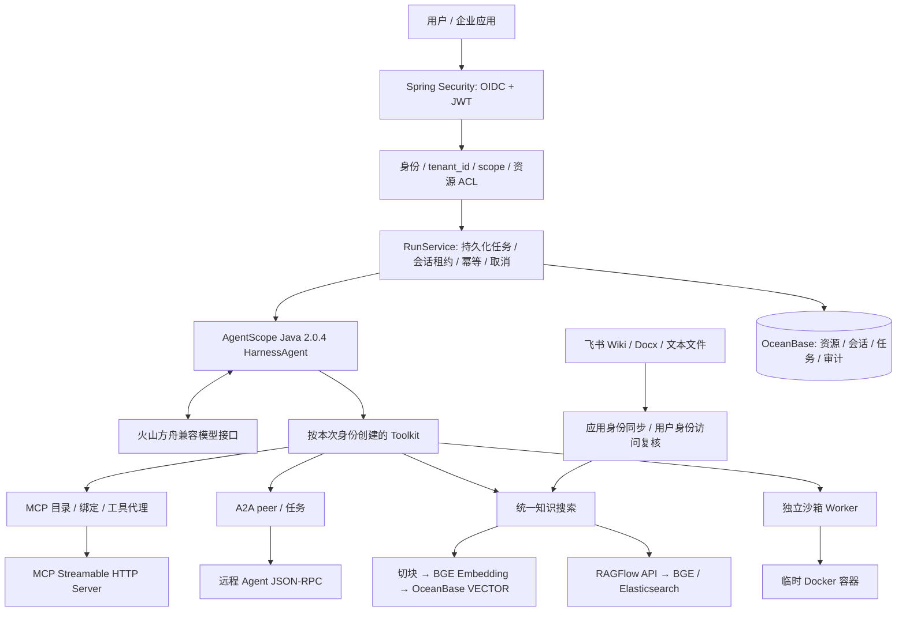

# 架构与授权

这是可运行的后端工程，包含本机验证栈和生产适配入口。生产部署还需接入企业身份提供方、凭证管理、部署治理和容量规划。

## MCP 的开发、接入与卸载

1. 开发工具：参考 `DemoMcpApplication`，用 MCP Java SDK 注册 `get_order` 的 JSON Schema 和执行函数。示例服务单独监听 8081，通过 Bearer token 保护 `/mcp`，不与 Runtime 共用模型上下文。
2. 管理员登记：`POST /api/mcp` 登记经过批准的 endpoint、工具白名单、readers 和凭证引用。出站地址必须与服务端 origin 白名单精确匹配。发现工具只能访问批准目录，不接受模型提供任意 URL 或进程启动命令。
3. 语言安装：具备 `mcp:manage` 的用户说“接入 orders MCP”，模型调用 `install_mcp`。服务端发现远端工具、校验白名单并保存 agent 与 connector 的绑定。新工具从下一轮生效。
4. 工具调用：本次身份必须有 `mcp:invoke`，能访问 agent 和 connector，connector 仍处于安装状态且工具仍在批准列表中。每次执行重新检查；已构建的 Toolkit 不能绕过后续撤销。
5. 语言卸载：`uninstall_mcp` 删除持久化绑定；已在执行的上游调用可能完成，后续派发被拒绝。卸载绑定不删除远程 MCP 服务。

模型只能看到工具说明和参数。真实凭证保存在环境变量或部署方凭证系统，通过 `RUNTIME_SECRET_*` 引用解析。HTTP 重定向关闭，不把当前用户 token 自动传给任意下游。

## A2A 的身份与授权

入站提供 A2A 0.3 JSON-RPC 的 `message/send`、`tasks/get`、`tasks/cancel` 以及认证保护的 Agent Card。消息创建异步任务；任务归属实际认证主体，查询和取消复核所有者。`messageId` 用于幂等，当前不声明 A2A 流式能力。

出站先登记 peer 的固定 endpoint、readers 和凭证引用。调用方需要 `a2a:invoke`；Agent 定义还必须允许该 peer。工具代理与远端服务各自校验权限。

| 场景 | 认证方式 | 下游身份 |
|---|---|---|
| 本机演示 | Basic，仅 local profile | 独立本机演示用户 |
| 固定服务凭证 | Bearer 引用 | 所配置的服务主体 |
| 应用互调 | OAuth2 client_credentials | 下游 audience/scope 限定的应用主体 |
| 代表用户委托 | OAuth2 Token Exchange | 授权服务器签发的目标用户委托 token |

Token Exchange 的 subject_token 只发送到批准的授权服务器。授权服务器需要配置调用客户端、允许的目标 audience、scope 和委托策略；Runtime 不签发 JWT，也不模拟授权服务器的许可结果。企业 OIDC 的入站 JWT 校验签名、issuer、audience、时间和必填 tenant_id/sub。

| 操作 | scope | 额外检查 |
|---|---|---|
| Agent 运行 | agent:run | Agent readers、会话所有者 |
| Agent 配置 | agent:manage | 当前 tenant 内资源 |
| MCP 登记/绑定 | mcp:manage | 目录白名单、connector readers |
| MCP 调用 | mcp:invoke | Agent、绑定、工具白名单、connector readers |
| A2A 登记 | a2a:manage | endpoint 白名单 |
| A2A 调用 | a2a:invoke | peer readers、Agent 允许列表 |
| KB 配置/写入/ACL | kb:manage | 当前 tenant 内资源 |
| KB 检索 | kb:read | KB readers、文档 readers、飞书实时访问复核 |
| 沙箱 | sandbox:execute | Agent 开关、Worker 容量、执行限制 |

tenant_id 和 sub 始终来自认证信息，不信任请求体或自定义身份 header。所有数据库资源按 tenant_id 隔离。`readers` 支持 `*`、`user:`、`group:<name>`；管理 scope 不自动绕过文档 ACL。

## 两种知识库引擎

统一入口为 `KnowledgeService` 与模型工具 `search_knowledge`。知识库按配置选择引擎；返回统一的文档 ID、片段、来源和分数。不同引擎分数未做跨库校准。

自建引擎按 Unicode 码点和段落切块、保留重叠，分批调用 Embedding。模型、维度和接口共同形成 profile；profile 变化要求重建知识库。写入按 generation 暂存，在事务中切换有效文档并清理旧块；搜索限定当前有效 generation。OceanBase 用原生 VECTOR 和 cosine_distance，文档 ACL 在 SQL 中预过滤；当前使用精确检索，单次最多 1000 个可读文档过滤条件。

RAGFlow 引擎负责上传、解析提交、检索和远端删除。Runtime 保留本地文档到远端文档 ID 的有效映射，查询只传入当前可读 document_ids；可读集合为空时直接返回空结果。上传返回 INDEXING 仅代表解析已提交，实际完成状态由 RAGFlow 管理。RAGFlow 本机栈采用独立 Elasticsearch；自建引擎继续使用 OceanBase，二者边界独立。

两个引擎在检索后、结果交给模型前重新读取 ACL。会话保留的知识证据也会复核，已失去访问权的旧知识轮次被移除。删除先提交本地撤销，再清理上游，避免清理故障恢复访问。RAGFlow 历史物理文件清理和失败重试队列属于后续运维扩展。

## 飞书知识库关联

`FeishuService` 将知识空间或子树绑定到任一知识库引擎。应用身份负责遍历节点、分页读取、比较正文变化并同步；完整遍历成功后才对账删除，局部失败不误删未访问到的内容。

服务支持 Docx 正文和 TXT/MD/CSV/JSON 文本附件，其余类型报告 skipped。检索使用提问者自己的飞书用户 token 对源文档实时复核；缺少授权、失效、无权限或检查异常均不召回。企业应用 scopes 和空间访问权限需在飞书侧配置。当前提供 token 引用接口，用户 OAuth 登录、刷新令牌和授权页面由部署系统对接；这些不能通过本地 Docker 替代。

## 沙箱与运行治理

沙箱脚本通过 Docker 标准输入进入 `/bin/sh -s`，避免 Windows/Linux 命令行引号差异。每次创建临时容器，无网络、非 root、只读根文件系统、无宿主机挂载，限制 CPU、内存、PID、输出和时间。超时后终止 CLI，并单独删除容器。生产 API 只调用独立 Worker，Docker socket 留在 Worker 主机。

当前执行器为单进程 4 个任务线程和 16 个排队位，任务与会话持久化，CAS 防止终态覆盖，幂等键避免重复提交。崩溃后的旧租约过期任务会标记失败，不自动重放外部副作用。SSE 为可重连状态快照，非逐 token 输出。生产扩容可在保持这些状态约束的前提下替换为分布式队列、租约调度器、统一 Secret Store、审计归档和监控。
